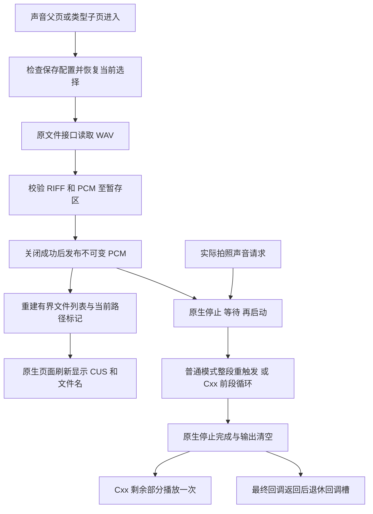

# 从 Z9 mark2 学习并向 Z8 移植自定义快门声

本文面向准备自行分析 Z8 固件的开发者，以 mark2 v14 的源码、接口和失败经验为学习材料。它不是可直接应用的 Z8 补丁。本仓库没有 Z8 音频地址表、Z8 精确输入 profile、可安装 Z8 固件或 Z8 实机验收；Z8 的目标固件版本须由移植者先确定。

Z9 集成测试包 v39 的使用者于 2026-11-05 反馈：升级后，重启进入音频菜单显示正常。该反馈支持此次菜单修复的实机效果；公开的独立 mark2 v14 有单独的构建布局与产物身份，不能把集成包反馈当作独立包或 Z8 的安装验收。照片 RAW 功能属于另一条开发线，本文仅讨论音频。

## 1. 先理解完整业务，再找相似函数

用户选文件并非一次“把 WAV 地址交给声卡”。完整流程如下：

持久配置、菜单行、当前绑定 PCM、正在播放的请求是四种状态。恢复其中一个，不代表其余三个已经同步。每次移植应分别观察它们，避免出现“能播放，但菜单仍是 A”“有文件名，但播放旧内容”或“停止通知到了，但 DMA 仍引用旧地址”。

## 2. 源码阅读顺序和可复用范围

| 阅读入口 | 学习内容 | 移植处理 |
|---|---|---|
| `firmware/mark2_import.h`、`mark2_import.c` | 有界 RIFF 解析、部分读取、关闭后提交、错误保留旧选择 | 与硬件分离较好；先在 Z8 项目独立运行合成测试 |
| `firmware/profile.h`、`profile.c` | 两份160B记录、序号、CRC和完整路径 | 可复用格式策略；必须重新验证卡盘符、写入与读回语义 |
| `firmware/mark2_native_file.c`、`profile_native.c` | 原生文件对象及 open/read/write/close 桥 | 所有地址、对象偏移、返回码和任务上下文均重新证明 |
| `firmware/picker.c` | 目录扫描、20行模型、原生选择、冷恢复、CUS与文件高亮 | 策略可复用；菜单布局、ID、原回调和标签解析需重定位 |
| `firmware/adapter.c` | 请求归属、普通模式、Cxx循环/尾段、退休和不可变缓存 | 状态机可参考；内部播放参数、回调、原生pending字段不能照抄 |
| `z9patch/builder.py` | 输入身份、原指令读取、跳板、RX/BSS和补丁清单 | 新建 Z8 profile 与构建入口；不要仅替换机型名和输入SHA |
| `tests/` | 冷菜单、缓存、配置桥、循环、回调及封包合成测试 | 先移植测试适配层；明确哪些接口为 mock |

音频输入当前限定 PCM format 1、48 kHz、双声道、16位小端，时长大于0且不超过1.5秒。每毫秒为192B，最大有效PCM为288000B；播放长度补齐到1ms，补齐区为零。这是 mark2 的策略，不是已经证明的 Z8 硬件上限。文件扫描只在卡根目录 `CUSTOM_SOUND` 的本层，最多20项，可打印ASCII文件名最长111字符。

## 3. 为 Z8 建立独立的接口台账

建议先建立以下表格，每行保留目标版本、模块SHA、输入地址空间、原窗口哈希、调用者、参数/返回、所有者及动态证据。表中 Z9 数字只用于在本仓库查找消费者；它们不是 Z8 地址，也不能推出一个统一地址差。

| 接口合同 | Z9 5.32 学习锚点 | Z8 必须证明的内容 |
|---|---|---|
| 父页进入/值刷新 | 初始化RAM槽 `A028F42A8` → ROM `405A54B4` | 确实是声音父页；进入时执行；原参数和线程允许文件RPC |
| 类型子页刷新 | `A028F42D8` → `405A575C` | 行模型何时读取、原标记何时应用、保留原刷新顺序 |
| 选择提交 | `405A57E0` | 内置A–E与新行分流；原通知不可跳过；显式A能关闭自定义 |
| 外层文字消费 | `405A5584` 调用点 | 仅替换本页 Type A 的显示；不污染其他页或原枚举 |
| 文件名标签解析 | `4032E57C` | 标签分类、编码、生命周期和表容量 |
| 菜单属性读取 | `403E74A8`，属性 `02005F0E` | Z8 属性编号、A映射、禁用条件及当前值来源 |
| 卡挂载/目录 | `4031C30C`、`402DA504`、`402DA358` | 卡槽→挂载身份、过滤位、枚举结束码、目录创建错误 |
| 文件对象构造/打开 | `408666F8`、`40866720` | 对象大小40B只是Z9合同；fd、长度字段和成功码重新验证 |
| 文件大小/读取/关闭 | `408669D4`、`408669F8`、`408667A8` | 部分读、零字节成功、打开后失败仍有fd、close失败的归属 |
| 创建/写入配置 | `40866780`、`408668AC` | 精确写长、close、重新打开及完整读回；不把成功返回当持久化 |
| 声音API与PCM钩子 | `40E355FC`、`40D25DD0` | 参数含义、被覆盖指令、返回处理、普通和Cxx调用者 |
| 最终回调退休 | `40E395B0`、`40E39728` | 原回调已经返回，当前请求与两个输出均空闲；不只看事件名 |
| 内存和缓存维护 | picker中的分配/flush消费者 | 原生分配池、对齐、容量、缓存清理方向及真正DMA地址 |

Z9 ROM地址按 `VA = module_offset + 0x40160000` 换算；仅已证明初始化RAM范围使用另一套映射。Z8 的 ROM、初始化RAM、BSS和运行时堆需要各自建立映射，禁止套用本表换算式处理全部地址。不能仅凭零区、反编译变量名或相似指令片段认定空闲空间和接口。

发现候选后，至少交叉核对调用者、参数宽度、结构字段消费者、原返回码、事件与错误分支。屏蔽PC相对地址后得到的相似函数只能作为候选；移植最容易漏掉的是返回后的写回、异常清理和另外一个输出消费者。

## 4. 冷启动菜单修复：v14 最重要的移植点

旧实现只在首次声音请求触发保存配置恢复。直接进菜单时尚未发生声音请求，因此父页显示A、子页没有文件。恢复音频也只发布PCM和已载路径，不重建文件行。即使文字钩子正确，未执行刷新时也不会改变已有UI快照。

v14 在原父页刷新前执行 `prepare_menu()`；直接进入子页也执行同样准备。它只在恢复状态被确认后建立文件模型，渲染文字函数保持无文件I/O。读取配置不调用“选择内置A”的处理器，也不写新配置序号。

自定义声音仍借用原生 Type A=0 的播放路由。原子页刷新会按原枚举给A画选中框，因此修复需在原刷新后清除A–E误选标记，再按卡和完整路径标记当前文件。第一次模型重建时还要移动焦点，否则文件可能在滚动窗口外。焦点标记消费后不应在每次刷新强制重置用户位置。

目录超过20项时，当前已选文件仍需占用有界模型中的一行；本实现用它替换最后一行，而非把上限扩成21。Z8 应先确认自己的菜单行ID和表空间，不直接复用 `7E20/7E21` 或 `C86` 标签范围。

Z9 独立实现用原启动清零的8192B新增BSS，适配器保留1536B，picker实际6304B。集成实现则通过已初始化的运行时堆/锚点访问同类状态，并有就绪门。两种内存合同不能混用；Z8 应明确选择并验证一种，不能直接复制固定地址。

## 5. 播放与内存生命周期

普通 S/CL/CH 复用原停止、等待、重新启动路径，每个实际照片请求从选中PCM开头重触发，不新增排队；最后一声可播完。快慢曝光的阶段入口、caller和flags需分别验证，不能只在一个声音演示入口试播。

Z9 C15 循环前50ms并保留原周期预算，其他Cxx循环前40ms；原生停止完成、输出清空后，剩余部分只播放一次。短于对应边界时循环完整补齐内容、不额外播放尾段。这些是Z9已恢复的声音合同，不是Z8的已知合同，也不是逐照片音效或相机帧率；Z8应先测原声的请求节奏和停止时序再决定前段长度。

最多20种不同PCM内容在本次启动保持不可变，另有一个未发布暂存区。相同内容按完整字节比较复用；相同路径仍重新读卡验证，不能只按路径命中。发生坏文件、分配失败或busy时保留旧选择。不能为实现无限切换而直接释放仍可能被DMA引用的旧PCM。

64个回调注册槽可以在原最终回调返回、请求及输出状态都清空后退休复用。一次“完成”通知本身不足以授权复用，更不足以授权释放PCM。Z8须重新恢复自己的序列化工作者、回调payload、错误码及拒绝后是否仍有最终退休的语义。

## 6. 持久化和双卡

`M2SND0.CFG`、`M2SND1.CFG` 是 mark2 自行定义的双记录，不是尼康系统配置格式。每份160B含版本、序号、enabled、完整路径和CRC；选择有效最新记录。写入应完成指定字节数、关闭后重新读取并逐字节比较。两个挂载卡同时有启用记录时，不能猜测用户选择。

新卡选择先完成新配置提交，再停用另一张已挂载卡的旧记录；不能先擦掉唯一旧选择。卡缺席时无法替它写“禁用”，应保留这项已知限制。当前首次恢复失败不会自动反复重试；如果Z8要增加插卡后重试，需设计新的会话/卡身份状态，不能每次绘制都重新绑定播放。

验证卡槽时同时记录物理卡槽、原挂载索引、路径盘符和配置来源，它们不是同一编号空间。双卡同名文件不能只比较basename。卡槽1/2切换、文件内容变化、缺失和歧义必须分别列测试。

## 7. 推荐的分步接入和放行条件

1. 固定一个Z8官方版本与精确模块SHA，保留原包和原始解包证据。恢复地址空间、原音频请求及最终消费者；不先修改所有菜单。
2. 在宿主运行导入器、配置和状态机合成测试，建立Z8桥的错误/部分读夹具。保留原A–E行为和坏输入拒绝。
3. 先接原播放API，用明确合成PCM验证实际输出字节、完成回调和停止；再接文件桥。进入函数或拿到状态成功码不算声音输出。
4. 接菜单提交与动态文件行，验证原生选择回退；再接父页/子页冷恢复、CUS和当前完整路径高亮。文字sink、UI对象、实际栅格三者交叉核对。
5. 分别验证普通S、CL、CH与每个支持的Cxx：首请求、重复请求、停止、尾段、busy、错误和最后一个消费者。每个假设变化启动新运行，避免用旧内存状态掩盖缺失初始化。
6. 在模拟器与设备分别做“菜单先进入”“声音先恢复再进菜单”“保存后重启”“按钮关机”“拔电池后启动”。这些不是同一种断电模型，模拟器进程重启不能代替物理验收。
7. 冻结新源码与严格profile后独立重建、封包、解包回验：其他模块字节不变，所有原空间改动有消费者、原/新哈希与长度。不同编译器得到不同字节时重新登记和验证，不关闭身份检查。

| 验证项 | 最少要观察的结果 | 常见漏检 |
|---|---|---|
| 冷菜单 | 无拍照前已显示CUS和正确文件行，无新增CFG写入 | 先试播一次才截图 |
| 拍后菜单 | 仍指向相同卡/文件，A–E选择正常 | 只检查selected变量，不看栅格 |
| WAV | 部分读和close错误不发布，padding为零，长度有效 | 只检查文件名和header |
| 声音 | 实际DMA源与当前PCM字节相同，停止后无活动请求 | 只有回调/计数或直接注入输出文件 |
| 双卡 | 卡2单独、同名不同内容、保存迁移和歧义拒绝 | 把挂载索引等同于卡槽或文件ID |
| 重触发 | 旧请求停止/退休后新代次生效，尾段不重复 | 仅验证单次播放 |
| 资源 | 缓存有界、重复选择不无限分配、回调复用有退休门 | 完成通知即释放PCM |
| 封装 | 精确输入、补丁白名单、CRC及独立整包回读 | 把CRC正确当成设备功能通过 |

## 8. 输出一份可复核的 Z8 移植记录

至少保存：目标版本和模块SHA、每个候选接口的证据、原/新补丁范围与哈希、内存布局/所有权合同、构建工具和flags、严格profile、独立回验、模拟器实际命令/模型SHA、测试失败与修订、每项实机结果和未验证范围。公开代码只保留自行编写源码、短接口常量、合成测试和身份元数据；原固件、原厂资源、反编译正文、私有格式材料和个人音频保持本地。

可直接使用本仓库 `tests/run.py` 学习如何覆盖生命周期；不能把它的mock通过变成Z8已通过。可参考 `z9patch/builder.py` 的“校验输入→局部生成→记录补丁→检查输出身份”顺序；不能修改Z9 profile让它接受任意Z8输入。最终Z8实现需要自己的模块SHA、ABI映射、构建身份与设备接受记录。

## 9. v15普通连拍重启的新增移植要点

先观察普通请求的kind/repeat/cap与实际调用者。Z9本次CH20记录是kind0/repeat0/cap0；不能因另一机型出现6/13/17/21/25就只修终段集合。原短声音复用门可以省略stop及新API，替换为完整长PCM后必须重新核对这一假设。v15仅在原生kind0准入、CUS已发布且Cxx/两种尾段无占用时进入原生停止/等待/重启；不清busy或时间戳。

在Z8重新定位该语义门、原生继续点与停止入口，不能直接复制Z9地址。完整保存调用者寄存器、NZCV与对齐栈；原字从自己的精确原模块读取。动态heap/ready合同和本仓库固定BSS不同，须先判断状态可用。

本次Z9声音请求为04210031/32，处理后的回调04212001/02与播放通知04212004/05分开；不要把回调编号误写成请求编号。直接stop32调用与定时器回调也须以LR/栈区分。先证明本机型时间计数频率、截止时间来源和等待原因，再比较快门条件；不能通过固定50ms或写完成位制造通过。

用户报告集成c4 CH20恢复正常，公开独立v15和Z8仍需各自安装/功能接受。Z9旧QEMU约65ms回归未覆盖实机坏分支；合成寄存器测试也不等于调度时序验证。
